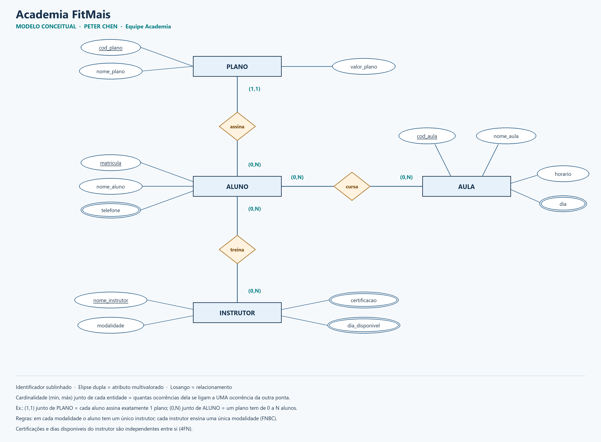
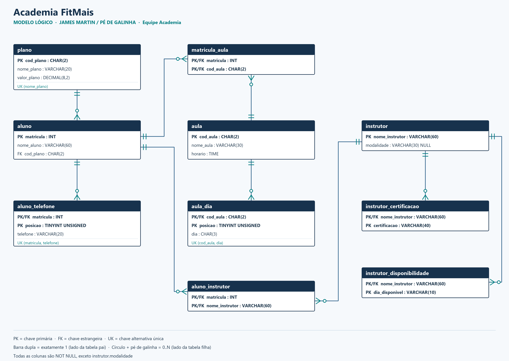

# Equipe 1: Academia FitMais

**Nome do time:** Equipe Academia

| Nome | Usuário do GitHub |
| --- | --- |
| Pedro Vale de Lima Bezerra | [@blackoutt444](https://github.com/blackoutt444) |
| Eduardo Baçal | A confirmar |
| Jonhonatan Uchoa | A confirmar |
| Daniel Villar | A confirmar |

## O cenário

O sistema da Academia FitMais hoje é uma planilha. Rode o `00_planilha.sql` no MySQL: ele cria o banco `normalizacao_academia` com 3 tabelas que reproduzem a planilha (também em `planilha.xlsx`).

| Tabela | O que guarda |
| --- | --- |
| `planilha` | Cada linha é a matrícula de um aluno em uma aula. Um aluno tem um plano e pode ter mais de um telefone. |
| `planilha_fnbc` | Regra: em cada modalidade, o aluno tem um único instrutor; cada instrutor ensina uma única modalidade. |
| `planilha_4fn` | Cada instrutor tem várias certificações e vários dias disponíveis, que não têm relação entre si. |

## Como rodar

Use MySQL 8.0.16 ou mais novo, porque as restrições `CHECK` dependem dessa versão. Rode os arquivos nesta ordem, no cliente `mysql` ou no Workbench, a partir da raiz do repositório:

```sql
SOURCE equipe-1-academia/00_planilha.sql;          -- banco e planilhas originais (arquivo do professor, sem alteração)
SOURCE equipe-1-academia/01_ddl.sql;               -- as 10 tabelas finais
SOURCE equipe-1-academia/02_migracao.sql;          -- carga com INSERT ... SELECT
SOURCE equipe-1-academia/03_prova_sem_perda.sql;   -- remontagem e prova sem perda
SOURCE equipe-1-academia/04_validacoes.sql;        -- dependências, contagens e o desafio da seção 9
```

O `00_planilha.sql` apaga e recria o banco `normalizacao_academia`. Para refazer a demonstração do começo, rode de novo a partir dele. O `01_ddl.sql` também pode ser rodado de novo sozinho: ele apaga e recria só as tabelas finais e não mexe nas planilhas.

**Onde foi testado:**

- MySQL Community Server **8.4.13**, com o modo SQL padrão (`ONLY_FULL_GROUP_BY` e `STRICT_TRANS_TABLES`).
- MariaDB **10.4.32**, a versão que vem no XAMPP, com o mesmo resultado.

## Hipóteses do modelo

- **Ordem das listas:** os telefones da `planilha` vêm separados por `; ` e os dias das aulas por `/`. A ordem em que aparecem é guardada na coluna `posicao`, para que a remontagem devolva exatamente o mesmo texto.
- **Horário:** é o horário de início da aula. Na planilha é texto (`07:00`); no modelo final vira `TIME`.
- **Nomes como identificador:** a `planilha_fnbc` e a `planilha_4fn` identificam alunos e instrutores só pelo nome.
  - Instrutor: o nome vira a chave da tabela `instrutor`, porque nenhum código foi fornecido.
  - Aluno: na `planilha_fnbc`, o aluno é ligado à matrícula do cadastro de alunos pelo nome. Os quatro alunos dessa planilha (Ana, Bruno, Carla e Diego) estão na `planilha`, e o `04_validacoes.sql` confere que nenhum nome se repete e que nenhum aluno ficou sem matrícula.
  - Num sistema real, os dois teriam um código próprio.
- **Cadastro independente:** aluno, aula, plano e instrutor podem ser cadastrados antes de se relacionarem, ou seja, com participação mínima zero nos relacionamentos N:N. A única exceção é o plano: todo aluno tem exatamente um.

## 1. Anomalias

| Anomalia | Exemplo na planilha |
| --- | --- |
| Inserção | A chave da planilha é (matricula, cod_aula). Um aluno que ainda não escolheu aula não pode ser cadastrado sem inventar um `cod_aula`. Do mesmo jeito, uma aula nova sem alunos (por exemplo, uma turma de Yoga) ou um plano novo ainda sem assinantes não cabem numa linha sem inventar uma matrícula. |
| Exclusão | Elisa Rocha (matrícula 105) só aparece na linha da aula A2 (Spinning). Se ela sair do Spinning e a linha for apagada, somem também o nome dela, os dois telefones ((92) 98285-1555 e (92) 98705-2615) e o registro de que ela assina o plano Trimestral. |
| Modificação | O plano Mensal (P1, R$ 129,90) se repete em 4 linhas: as duas de Ana Souza e as duas de Carla Dias. Um reajuste exige alterar as 4. Se só uma for alterada, o mesmo plano passa a ter dois preços. O mesmo vale para o horário da Musculação (A1, 07:00, Seg/Qua/Sex), repetido nas linhas de Ana, Bruno e Diego. |

## 2. Dependências funcionais da `planilha`

| Determinante | Determina | Tipo (total, parcial ou transitiva) |
| --- | --- | --- |
| matricula | nome_aluno, telefones, cod_plano | Parcial: depende só de parte da chave (matricula, cod_aula) |
| cod_aula | nome_aula, horario, dias | Parcial: depende só de parte da chave |
| cod_plano | nome_plano, valor_plano | Transitiva: matricula → cod_plano → nome_plano, valor_plano |
| (matricula, cod_aula) | todos os atributos | Total: a chave inteira identifica a linha; nenhum atributo depende só dela, sem ser por uma das dependências acima |

**Chave primária da `planilha`:** **(matricula, cod_aula)**. O aluno 101 aparece em duas aulas e a aula A1 aparece para três alunos, então nenhuma das duas colunas sozinha identifica a linha. O `04_validacoes.sql` confere que as 12 linhas têm pares (matricula, cod_aula) distintos e que as dependências acima valem nos dados.

## 3. Normalização passo a passo

**1FN:** havia dois campos com vários valores numa célula.

- `telefones`, por exemplo `(92) 98137-1111; (92) 98541-2123` para Ana Souza, virou `aluno_telefone(matricula, posicao, telefone)`, com uma linha por telefone.
- `dias`, por exemplo `Seg/Qua/Sex` para a Musculação, guarda três dias numa célula e fere a 1FN do mesmo jeito. Virou `aula_dia(cod_aula, posicao, dia)`.
- A migração separa os valores com `SUBSTRING_INDEX` e guarda a posição de cada um. A prova remonta o texto com `GROUP_CONCAT(... ORDER BY posicao SEPARATOR '; ')` e `'/'`.

**2FN:** com a chave (matricula, cod_aula), havia dependências parciais.

- `matricula → nome_aluno, cod_plano` (e, por meio de `cod_plano`, `nome_plano, valor_plano`).
- `cod_aula → nome_aula, horario`.
- Cada grupo foi para uma tabela cujo determinante é a chave: `aluno(matricula, nome_aluno, cod_plano, nome_plano, valor_plano)` e `aula(cod_aula, nome_aula, horario)`.
- Da relação original sobrou só a chave: `matricula_aula(matricula, cod_aula)`.

**3FN:** na tabela `aluno` da etapa anterior havia a transitiva `matricula → cod_plano → nome_plano, valor_plano`. Os dados do plano foram para `plano(cod_plano, nome_plano, valor_plano)`, e `aluno` ficou só com a FK `cod_plano`. Assim, o preço de cada plano fica guardado uma única vez.

**Esquema final em 3FN** (PK em negrito):

- `plano(`**`cod_plano`**`, nome_plano, valor_plano)`. `nome_plano` também é único (UK).
- `aluno(`**`matricula`**`, nome_aluno, cod_plano)`. FK `cod_plano → plano`.
- `aluno_telefone(`**`matricula, posicao`**`, telefone)`. FK `matricula → aluno`; UK (matricula, telefone).
- `aula(`**`cod_aula`**`, nome_aula, horario)`.
- `aula_dia(`**`cod_aula, posicao`**`, dia)`. FK `cod_aula → aula`; UK (cod_aula, dia).
- `matricula_aula(`**`matricula, cod_aula`**`)`. FK `matricula → aluno` e FK `cod_aula → aula`.

## 4. FNBC: `planilha_fnbc`

**Dependências funcionais:**

- (aluno, modalidade) → instrutor: em cada modalidade, o aluno tem um único instrutor.
- instrutor → modalidade: cada instrutor ensina uma única modalidade.

**Chaves candidatas:** **(aluno, modalidade)** e **(aluno, instrutor)**. As duas se sobrepõem no atributo `aluno`.

**Dependência que viola a FNBC:** instrutor → modalidade.

- O determinante `instrutor` não é superchave: Júlia aparece com Ana e com Bruno.
- A tabela está na 3FN, porque `modalidade` faz parte de uma chave candidata, mas não está na FNBC.
- Consequência: o fato "Júlia ensina Natação" está gravado duas vezes. Se Diego deixar a Natação, some o registro de que Tiago ensina Natação. E não dá para cadastrar um instrutor sem aluno.

**Decomposição:**

- `instrutor(`**`nome_instrutor`**`, modalidade)`.
- `aluno_instrutor(`**`matricula, nome_instrutor`**`)`, com FK para `aluno` e para `instrutor`.

A decomposição é sem perda porque o atributo comum (`nome_instrutor`) é chave de `instrutor`: a prova devolve as 8 linhas, sem faltar e sem sobrar.

**Custo conhecido da FNBC:** a dependência (aluno, modalidade) → instrutor deixa de caber numa única tabela, então não é preservada pelas restrições de uma tabela só. O `04_validacoes.sql` vigia essa regra: aluno com dois instrutores na mesma modalidade, resultado 0. Num sistema real, ela seria garantida por trigger ou pela aplicação.

## 5. 4FN: `planilha_4fn`

**Dependências multivaloradas:**

- **instrutor →→ certificacao**
- **instrutor →→ dia_disponivel**

As certificações e os dias são independentes entre si. Para cada instrutor, a tabela traz todas as combinações certificação × dia:

- Rafael: 2 × 2 = 4 linhas;
- Júlia: 2 × 3 = 6 linhas;
- Paula: 1 × 1 = 1 linha.

A única chave é o conjunto dos três atributos e não há dependência funcional não trivial, então a tabela está na FNBC. Mesmo assim, viola a 4FN: para Júlia ganhar mais um dia, seria preciso inserir duas linhas, uma para cada certificação. Se uma delas fosse esquecida, a tabela passaria a sugerir uma relação entre certificação e dia que não existe.

**Decomposição:**

- `instrutor_certificacao(`**`nome_instrutor, certificacao`**`)`, com 5 linhas.
- `instrutor_disponibilidade(`**`nome_instrutor, dia_disponivel`**`)`, com 6 linhas.

As duas têm FK para `instrutor`. A junção das duas pelo instrutor devolve as 11 linhas originais.

## 6. Modelagem

### 6.1 Modelo conceitual (Peter Chen)

**Entidades:**

- **PLANO**: identificador `cod_plano`; atributos `nome_plano` e `valor_plano`.
- **ALUNO**: identificador `matricula`; atributo `nome_aluno`; `telefone` multivalorado.
- **AULA**: identificador `cod_aula`; atributos `nome_aula` e `horario`; `dia` multivalorado.
- **INSTRUTOR**: identificador `nome_instrutor`; atributo `modalidade`; `certificacao` e `dia_disponivel` multivalorados.

**Relacionamentos:**

- **assina** (ALUNO–PLANO): cada aluno assina (1,1) plano; um plano tem (0,N) alunos.
- **cursa** (ALUNO–AULA, N:N): (0,N) dos dois lados.
- **treina** (INSTRUTOR–ALUNO, N:N): (0,N) dos dois lados, com a regra da FNBC anotada no diagrama.

As cardinalidades seguem a convenção do brModelo: o par (mín, máx) escrito junto de uma entidade diz quantas ocorrências dela se ligam a uma ocorrência da outra ponta.



### 6.2 Modelo lógico (James Martin, pé de galinha)

São as 10 tabelas finais do `01_ddl.sql`, com PK, FK e UK. Cada linha liga uma tabela pai (barra dupla = exatamente 1) a uma tabela filha (círculo e pé de galinha = 0..N). Os relacionamentos N:N do modelo conceitual viraram as tabelas associativas `matricula_aula` e `aluno_instrutor`. Os atributos multivalorados viraram `aluno_telefone`, `aula_dia`, `instrutor_certificacao` e `instrutor_disponibilidade`.



## 7. Dicionário de dados

O arquivo [`dicionario_dados.md`](dicionario_dados.md) descreve **todas** as 10 tabelas finais: tipo, tamanho, nulo, chave, descrição e restrição de cada coluna.

## 8. Prova de junção sem perda

O `03_prova_sem_perda.sql` cria três views que remontam as planilhas por JOIN:

- `vw_planilha_reconstruida`, que usa `GROUP_CONCAT` para refazer as listas de telefones e dias;
- `vw_planilha_fnbc_reconstruida`;
- `vw_planilha_4fn_reconstruida`.

Depois, compara cada view com a original usando `NOT EXISTS` nos dois sentidos, em todas as colunas. A comparação é byte a byte (`CAST(... AS BINARY)`): sem isso, a collation do banco consideraria iguais "Fábio" e "Fabio", ou "Pilates" e "pilates", e uma diferença dessas passaria despercebida.

Resultado no MySQL 8.4.13 (o mesmo no MariaDB 10.4.32):

```
+---------------+-----------------+---------------------+----------+----------+
| tabela        | linhas_original | linhas_reconstruida | faltando | sobrando |
+---------------+-----------------+---------------------+----------+----------+
| planilha      |              12 |                  12 |        0 |        0 |
| planilha_fnbc |               8 |                   8 |        0 |        0 |
| planilha_4fn  |              11 |                  11 |        0 |        0 |
+---------------+-----------------+---------------------+----------+----------+
```

Para ter certeza de que a prova detecta erros, fizemos alterações de propósito, dentro de transações desfeitas logo em seguida:

| Alteração | Resultado da prova |
| --- | --- |
| "Fábio Nunes" virou "Fabio Nunes" (só o acento) | planilha: faltando 2, sobrando 2 |
| "Pilates" virou "pilates" (só a maiúscula) | planilha: faltando 3, sobrando 3 |
| Ordem dos dois telefones de Ana invertida | planilha: faltando 2, sobrando 2 |
| Matrícula de Elisa no Spinning apagada | planilha: 11 reconstruídas, faltando 1 |
| Vínculo Diego–Tiago apagado | planilha_fnbc: 7 reconstruídas, faltando 1 |
| Dia a mais para Paula | planilha_4fn: 12 reconstruídas, sobrando 1 |

## 9. Desafio: uma decomposição errada

Uma decomposição errada da `planilha_fnbc` é separar em **R1(aluno, modalidade)** e **R2(modalidade, instrutor)**. O atributo comum, `modalidade`, não é chave de nenhuma das duas: a Musculação tem dois instrutores (Rafael e Marcos), e a Natação também (Júlia e Tiago).

| R1: aluno | modalidade |
| --- | --- |
| Ana Souza | Musculação |
| Ana Souza | Natação |
| Bruno Lima | Musculação |
| Bruno Lima | Natação |
| Carla Dias | Dança |
| Carla Dias | Musculação |
| Diego Alves | Dança |
| Diego Alves | Natação |

| R2: modalidade | instrutor |
| --- | --- |
| Dança | Paula |
| Musculação | Marcos |
| Musculação | Rafael |
| Natação | Júlia |
| Natação | Tiago |

Junção (está no `04_validacoes.sql`):

```sql
WITH r1 AS (SELECT DISTINCT aluno, modalidade FROM planilha_fnbc),
     r2 AS (SELECT DISTINCT modalidade, instrutor FROM planilha_fnbc)
SELECT r1.aluno, r1.modalidade, r2.instrutor
FROM r1
JOIN r2 ON r2.modalidade = r1.modalidade;
```

A junção devolve **14 linhas para 8 originais**, ou seja, **6 tuplas espúrias**. Cada aluno de Musculação ou Natação aparece também com o outro instrutor da modalidade:

| aluno | modalidade | instrutor (falso) |
| --- | --- | --- |
| Ana Souza | Musculação | Marcos |
| Bruno Lima | Musculação | Rafael |
| Carla Dias | Musculação | Marcos |
| Ana Souza | Natação | Tiago |
| Bruno Lima | Natação | Tiago |
| Diego Alves | Natação | Júlia |

A informação perdida é qual dos instrutores da modalidade atende cada aluno. A decomposição certa (seção 4) junta pelo `instrutor`, que é chave de `instrutor`, e por isso não gera nenhuma linha falsa.

## Validação

Além da prova, a solução passou por uma bateria automática de 22 verificações no MySQL 8.4.13:

- carga completa do zero, duas vezes seguidas;
- `01_ddl.sql` rodado de novo sem afetar as planilhas;
- migração sem nenhum `VALUES`;
- 11 verificações de dependência com 0 violação;
- contagem das 10 tabelas;
- as 6 tuplas espúrias do desafio, conferidas uma a uma;
- 10 restrições (PK, FK, UK, CHECK e exclusão restrita) recusando dados inválidos;
- os 6 testes de sensibilidade da seção 8.

Contagem final das tabelas:

| plano | aluno | aluno_telefone | aula | aula_dia | matricula_aula | instrutor | aluno_instrutor | instrutor_certificacao | instrutor_disponibilidade |
| --- | --- | --- | --- | --- | --- | --- | --- | --- | --- |
| 3 | 6 | 9 | 4 | 9 | 12 | 5 | 8 | 5 | 6 |

## Autoria

A primeira versão desta solução foi preparada na conta do Pedro, com assistência de IA (Claude), a pedido dele, e revisada contra o enunciado. Os demais integrantes registram suas contribuições e revisões em commits próprios.
