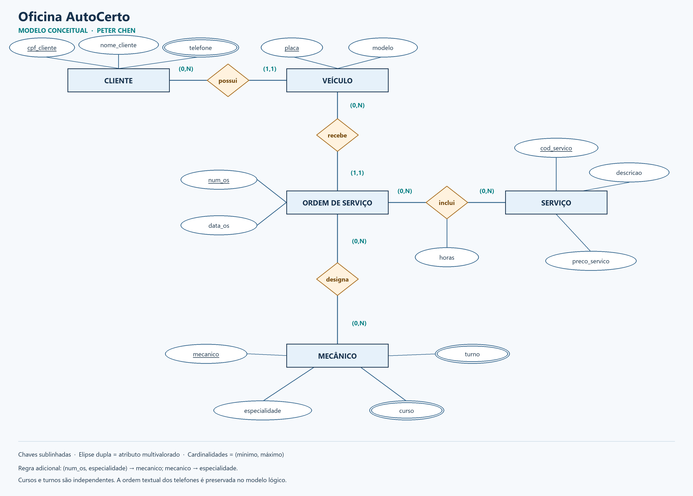
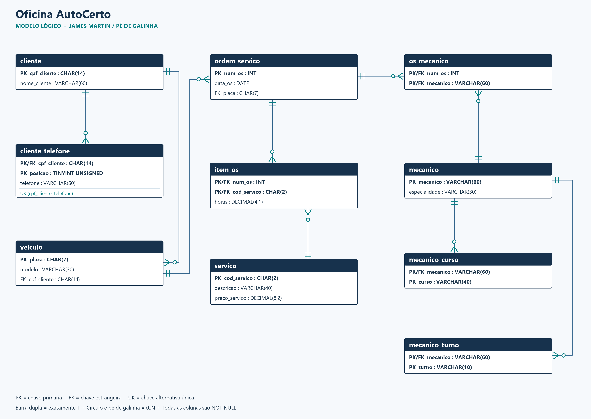

# Equipe 2: Oficina AutoCerto

**Nome do time:** Oficina AutoCerto — nome de trabalho, a confirmar com o grupo

| Integrante | Usuário do GitHub |
| --- | --- |
| Pedro — confirmar nome completo | [blackoutt444](https://github.com/blackoutt444) |
| Eduardo — confirmar nome completo | A confirmar |

**Cenário escolhido:** Oficina AutoCerto, equipe 2, confirmado pelo Pedro em 09/11/2026. Os nomes completos, o nome definitivo do time e a lista completa de integrantes ainda precisam ser confirmados pelo grupo.

**Repositório de trabalho:** [fork do Pedro](https://github.com/blackoutt444/bd1-normalizacao-engs251m02), branch `oficina-autocerto`. A solução está disponível nessa branch para revisão do grupo. O envio final por PR ao professor e a entrega no Classroom continuam pendentes.

**Autoria e revisão:** a solução inicial foi preparada na conta do Pedro com assistência do ChatGPT, a pedido dele. As contribuições dos demais integrantes devem ser registradas por seus próprios commits, após revisão e compreensão da solução.

**Disciplina:** Banco de Dados I, ENGS251M02. **Professor:** Aguinaldo Alves Braga Neto. **Entrega e apresentação:** 27/11/2026; no Classroom, prazo às 23h59.

## Como reproduzir

Use MySQL 8.0.16 ou posterior, preferencialmente MySQL 8.4. Os scripts foram executados em **MySQL Community Server 8.4.13**, com o modo SQL padrão, incluindo `ONLY_FULL_GROUP_BY`.

Execute os arquivos, nesta ordem, no cliente `mysql` ou no MySQL Workbench:

```sql
SOURCE equipe-2-oficina/00_planilha.sql;
SOURCE equipe-2-oficina/01_ddl.sql;
SOURCE equipe-2-oficina/02_migracao.sql;
SOURCE equipe-2-oficina/03_prova_sem_perda.sql;
SOURCE equipe-2-oficina/04_validacoes.sql;
```

Os caminhos acima são relativos à raiz do repositório; no Workbench também é possível abrir cada arquivo. `00_planilha.sql`, fornecido pelo professor e mantido sem alterações, **recria o banco de demonstração `normalizacao_oficina`**. `01` e `02` pressupõem as tabelas finais ainda vazias. Para refazer toda a demonstração, recomece pelo `00` em uma instância destinada ao exercício.

## O cenário e as hipóteses do modelo

Cada linha de `planilha` é um serviço realizado em uma ordem de serviço (OS). Cada OS é de um veículo, e cada veículo tem um dono no recorte temporal apresentado. `planilha_fnbc` associa OS, especialidade e mecânico; `planilha_4fn` combina cursos e turnos independentes.

Hipóteses usadas, compatíveis com o enunciado e os dados fornecidos:

- Um código de serviço aparece no máximo uma vez em cada OS. A duração pode variar de uma OS para outra.
- O preço é o preço do catálogo do serviço. Se houvesse preço histórico negociado por OS, ele pertenceria ao item e a dependência funcional seria diferente.
- O nome identifica o mecânico neste conjunto didático. Num sistema de produção, seria utilizado um identificador estável próprio.
- Clientes, veículos, OS e serviços podem ser cadastrados antes de seus relacionamentos: participação mínima zero do lado que recebe vários registros. Cada registro filho com FK pertence exatamente a um pai.
- Os telefones são fatos do cliente. A posição é guardada para reconstituir a ordem textual original; as listas de entrada usam o separador `; ` e não repetem o mesmo telefone do cliente.

## 1. Anomalias

| Anomalia | Exemplo real da planilha |
| --- | --- |
| Inserção | Não é possível representar um novo cliente ou um serviço ainda não realizado como uma linha completa da planilha: seria necessário inventar uma OS/serviço ou manter uma linha incompleta. No modelo final, o cadastro do cliente e o catálogo de serviços existem separadamente. |
| Exclusão | A OS 5002 tem apenas o serviço S3. Apagar essa linha também eliminaria da planilha os dados de Luana Prado e do Onix LT, placa XYZ9K88. |
| Modificação | Marcos Reis, CPF 111.111.111-11, aparece em três linhas: duas da OS 5001 e uma da OS 5005. Alterar o nome ou os telefones em apenas uma delas criaria versões conflitantes do mesmo cliente. |

## 2. Dependências funcionais da `planilha`

**Chave candidata e chave primária lógica:** **(num_os, cod_servico)**. O arquivo original não declara PK, mas a combinação identifica suas nove linhas. As hipóteses acima definem o significado dessa chave, e `04_validacoes.sql` também confere a unicidade na amostra.

| Determinante | Determina | Tipo em relação à chave composta original |
| --- | --- | --- |
| num_os | data_os, placa | Parcial: usa apenas uma parte da chave |
| cod_servico | servico, preco_servico | Parcial |
| (num_os, cod_servico) | horas | Total: as horas pertencem à execução daquele serviço naquela OS |
| placa | modelo, cpf_cliente | Transitiva a partir de num_os |
| cpf_cliente | nome_cliente, telefones | Transitiva a partir de placa/num_os |

Não se deve concluir `cod_servico → horas`: S3 tem 2,0 horas na OS 5002 e 2,5 na 5004; S4 tem 3,0 horas na OS 5003 e 2,0 na 5004.

## 3. Normalização passo a passo

**1FN.** O campo `telefones` contém uma lista: Marcos Reis, por exemplo, tem dois números na mesma célula. Ele é retirado da relação principal e decomposto em `cliente_telefone(cpf_cliente, posicao, telefone)`, com uma ocorrência por linha. A posição é metadado derivado pelo algoritmo, não redigitação dos números. A migração usa `SUBSTRING_INDEX`; a remontagem usa `GROUP_CONCAT` ordenado por posição.

**2FN.** As dependências parciais são separadas: `ordem_servico` recebe os fatos determinados pela OS; `servico`, os determinados pelo código do serviço; `item_os` conserva somente a chave composta e `horas`. Nesta etapa intermediária, os dados de veículo e dono ainda poderiam acompanhar a OS, mas seriam transitivos.

**3FN.** Eliminam-se as cadeias `num_os → placa → modelo, cpf_cliente` e `cpf_cliente → nome_cliente`: criam-se `veiculo` e `cliente`. A OS guarda apenas sua própria data e a referência ao veículo. Os seis esquemas resultantes não têm dependências parciais ou transitivas de atributos não primos sob as hipóteses declaradas.

### Esquema final em 3FN

- `cliente(`**`cpf_cliente`**`, nome_cliente)`.
- `cliente_telefone(`**`cpf_cliente, posicao`**`, telefone)`, FK `cpf_cliente → cliente`, chave candidata adicional `(cpf_cliente, telefone)`.
- `veiculo(`**`placa`**`, modelo, cpf_cliente)`, FK `cpf_cliente → cliente`.
- `ordem_servico(`**`num_os`**`, data_os, placa)`, FK `placa → veiculo`.
- `servico(`**`cod_servico`**`, descricao, preco_servico)`; `descricao` preserva a coluna original `servico`.
- `item_os(`**`num_os, cod_servico`**`, horas)`, FKs para `ordem_servico` e `servico`.

## 4. FNBC: `planilha_fnbc`

Considere `R(num_os, especialidade, mecanico)` e as regras fornecidas:

1. `(num_os, especialidade) → mecanico`.
2. `mecanico → especialidade`.

As duas **chaves candidatas** são `(num_os, especialidade)` e `(num_os, mecanico)`. A segunda funciona porque o mecânico determina a especialidade, e ambas são mínimas. A especialidade sozinha não determina o mecânico: há Igor e Gabriel em Freios.

`mecanico → especialidade` **viola a FNBC**, porque o determinante não é superchave de R. A relação satisfaz 3FN quanto a essa DF, pois `especialidade` é atributo primo, mas isso não basta para FNBC.

**Decomposição correta:**

- `mecanico(`**`mecanico`**`, especialidade)`.
- `os_mecanico(`**`num_os, mecanico`**`)`, com FKs para OS e mecânico.

A interseção é `{mecanico}`, que determina integralmente a primeira relação; portanto a decomposição binária tem junção sem perda. O JOIN por mecânico reconstitui as oito triplas originais.

**Preservação de dependências:** essa decomposição não preserva localmente `(num_os, especialidade) → mecanico`. PK/FK sozinhas não impedem inserir dois mecânicos de mesma especialidade na mesma OS. A consulta `um_mecanico_por_os_e_especialidade` em `04_validacoes.sql` identifica exatamente esse caso e retorna zero no conjunto correto. Num sistema operacional, seria necessária uma validação transacional ou trigger com controle de concorrência para impor a regra a futuras alterações. A prova de junção sem perda e a preservação de todas as DFs são propriedades distintas.

## 5. 4FN: `planilha_4fn`

Em `R(mecanico, curso, turno)`, curso e turno são independentes. Carlos, por exemplo, tem dois cursos e dois turnos, representados pelas quatro combinações.

- Dependências multivaloradas: `mecanico ↠ curso` e `mecanico ↠ turno`.
- São não triviais, e `mecanico` não é superchave da relação ternária: há violação da 4FN.
- A chave da relação original é `(mecanico, curso, turno)`.
- Decomposição: `mecanico_curso(`**`mecanico, curso`**`)` e `mecanico_turno(`**`mecanico, turno`**`)`, ambas com FK para `mecanico`.

As duas relações binárias ficam em 4FN. Sua junção por mecânico é sem perda **sob a independência declarada no enunciado**: Carlos produz 2 × 2 = 4 linhas, Renan 1 × 2 = 2, e Wesley 2 × 1 = 2, totalizando oito. Se cursos fossem válidos somente em certos turnos, essa hipótese deixaria de valer e a decomposição não seria apropriada.

## 6. Modelagem

### 6.1 Modelo conceitual — Peter Chen

Retângulos representam entidades; losangos, relacionamentos; elipses, atributos. Identificadores estão sublinhados. `telefone`, `curso` e `turno` têm elipses duplas; curso e turno são independentes. O relacionamento entre OS e Serviço tem o atributo `horas`.



As cardinalidades mínimas e máximas estão nas pontas dos relacionamentos. A regra adicional de uma responsabilidade por OS/especialidade está anotada no modelo, pois não é expressável apenas pela cardinalidade binária OS–Mecânico.

### 6.2 Modelo lógico — James Martin, pé de galinha

O modelo apresenta as **dez tabelas finais**, seus atributos, PK, FK, chave alternativa e os nove relacionamentos. A barra dupla indica exatamente um; círculo com pé de galinha, zero ou muitos. As tabelas originais de estágio não são parte do modelo final.



Os arquivos SVG equivalentes acompanham os PNGs para edição e impressão.

## 7. Dicionário de dados

O arquivo [`dicionario_dados.md`](dicionario_dados.md) documenta as dez tabelas: tipos, tamanhos, nulabilidade, chaves, referências e restrições. `01_ddl.sql` usa InnoDB e declara explicitamente todas as PKs e FKs. Não há exclusão em cascata: o comportamento restritivo evita apagar fatos dependentes sem uma decisão explícita.

## 8. Prova de junção sem perda

`03_prova_sem_perda.sql` cria três views de reconstrução e compara **todas as colunas**. A comparação textual é binária e o agrupamento conta a multiplicidade das linhas, para que nem diferenças de caixa/acentos nem duplicações sejam escondidas pela collation ou por um `DISTINCT` no resultado final.

Resultado executado no MySQL 8.4.13:

| tabela | linhas_original | linhas_reconstruida | faltando | sobrando |
| --- | ---: | ---: | ---: | ---: |
| planilha | 9 | 9 | 0 | 0 |
| planilha_fnbc | 8 | 8 | 0 | 0 |
| planilha_4fn | 8 | 8 | 0 | 0 |

Há ainda testes que introduzem temporariamente defeitos: linha faltante, linha extra, horas alteradas, troca de ordem dos telefones, mudança de caixa do nome e duplicação na origem. A prova detectou todos, e os testes desfizeram essas mudanças com `ROLLBACK`. O relatório é [`validacao_mysql.md`](validacao_mysql.md).

Contagens finais: 4 clientes, 6 telefones, 5 veículos, 5 OS, 4 serviços, 9 itens, 5 mecânicos, 8 responsabilidades, 5 vínculos mecânico–curso e 5 vínculos mecânico–turno.

## 9. Desafio: uma decomposição errada

Uma escolha errada é projetar R em `(num_os, especialidade)` e `(especialidade, mecanico)` e depois unir somente por especialidade:

```sql
WITH os_especialidade AS (
  SELECT DISTINCT num_os, especialidade FROM planilha_fnbc
), especialidade_mecanico AS (
  SELECT DISTINCT especialidade, mecanico FROM planilha_fnbc
)
SELECT oe.num_os, oe.especialidade, em.mecanico
FROM os_especialidade AS oe
JOIN especialidade_mecanico AS em USING (especialidade);
```

Essa junção tem **10 linhas em vez de 8**. Surgem duas tuplas espúrias:

| num_os | especialidade | mecanico |
| ---: | --- | --- |
| 5002 | Freios | Gabriel |
| 5004 | Freios | Igor |

Na origem, Igor é o responsável por Freios da OS 5002, e Gabriel, da OS 5004. Como `especialidade` não determina `mecanico`, a decomposição perde essa associação e gera combinações falsas. A última consulta de `04_validacoes.sql` lista exatamente as duas linhas.

## Organização da entrega e apresentação

Consulte [`roteiro_apresentacao.md`](roteiro_apresentacao.md) e [`pendencias_equipe.md`](pendencias_equipe.md). O professor exige trabalho somente nesta pasta, fork do repositório, pelo menos **3 commits reais por integrante** e PR com o título `Equipe 2 – Oficina AutoCerto`. A autoria dos colegas não deve ser simulada: cada integrante precisa revisar e contribuir com sua própria conta.

## Fontes

- [Enunciado geral do professor](https://github.com/agnpreto/bd1-normalizacao-engs251m02).
- [Cenário e dados originais da Oficina](https://github.com/agnpreto/bd1-normalizacao-engs251m02/tree/main/equipe-2-oficina).
- [MySQL 8.4: GROUP_CONCAT](https://dev.mysql.com/doc/refman/8.4/en/aggregate-functions.html#function_group-concat).
- [MySQL: operador de comparação NULL-safe](https://dev.mysql.com/doc/refman/8.0/en/comparison-operators.html#operator_equal-to).
